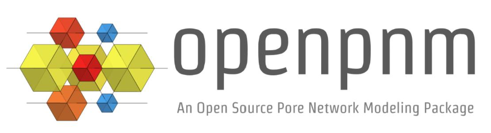

.. _front_page:

.. module:: openpnm
   :noindex:

#########################################
Pore Network Modeling Framework in Python
#########################################

What is OpenPNM? |stars|
########################

OpenPNM is an open source project to provide porous media researchers
with a ready-made framework for performing a wide range of pore network
simulations.

.. image:: https://user-images.githubusercontent.com/14086031/188250733-9d08db14-7822-4ba7-97a5-af148e1deabb.png
   :name: banner2

.. admonition:: Extract and Validate OpenPNM-Compatible Networks with PoreStore
   :class: tip

   Looking for volumetric 3D image analysis in the cloud without local
   setup? `PoreStore <https://porestore.com/>`_ — built by the creators of
   OpenPNM and PoreSpy — extracts OpenPNM-ready pore networks alongside
   direct 3D permeability, diffusivity, and tortuosity solvers.

.. toctree::
   :hidden:
   :maxdepth: 0

   installation
   modules/index
   _examples/index

----

How To Cite
###########

If you use OpenPNM in a publication, please add the following citation:

.. admonition:: Citation

    Gostick J, Aghighi M, Hinebaugh J, Tranter T, Hoeh MA, Day H,
    Spellacy B, Sharqawy MH, Bazylak A, Burns A, Lehnert W.
    **OpenPNM: a pore network modeling package**. *Computing in
    Science & Engineering*. 2016 May 25;18(4):60-74.
    `doi:10.1109/MCSE.2016.49 <https://doi.org/10.1109/MCSE.2016.49>`_.

.. |stars| image:: https://img.shields.io/github/stars/PMEAL/OpenPNM.svg?style=social&label=Star&maxAge=2592000
   :target: https://GitHub.com/PMEAL/OpenPNM/stargazers/
